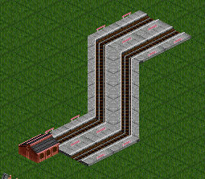
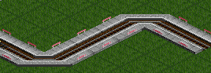

# 斜向铁路车站

## 在已有轨道上建站

1. 在等高的平地上先铺一段画面中横向或纵向的铁路。建站范围内若有信号，先拆除信号。
2. 打开铁路车站建造窗口，选择「斜向股道」。从要加站台的那一股轨道开始，沿轨道拖到末端。同格的两条平行股道可以分别建站，起点的点击位置决定选中哪一股。
3. 要延伸已有车站，沿相邻轨道继续拖建，或使用游戏现有的站点合并功能。点回普通站台方向即可继续建普通站台。
4. 要拆除其中一侧站台，在建站工具中启用移除模式，沿该股拖动。按住 Ctrl 可同时拆掉所选股道的铁轨。

可以先建一股站台，之后用铺轨工具补建平行股道。邻股可以铺设不同轨型、保留为通过线，或在不同位置起止。轨道预约和站台占用分别按股道判断。

## 折线站台与列车订单

内置普通站台与斜向站台在同站、等高且轨道相接时可以构成连续站台。近端、中部、远端停车位置以及装卸范围均沿列车所在的股道计算。YAPF 寻路选择到站路线时，以连续站台的实际长度判断列车是否放得下。

解挂时整列车须位于同一段连续站台上。车头和车尾之间夹有裸轨，或中间车辆位于另一股道，均不满足站台条件。接挂时按实际接触端确定编组方向，并沿轨道调整车辆间距。客货随原车厢保留。

## 蓝图与兼容性

蓝图按股道记录轨型和站台位置，支持旋转、镜像、粘贴和撤销。向既有站台旁补建第二股后，撤销仅移除本次增建部分。蓝图格式写出 v7，可读取 v3–v6。

旧存档加载时会初始化斜向站台使用的地块标记。斜向站台使用随游戏分发的内置双侧站台图形，目前仅支持等高平地上的既有轨道。
